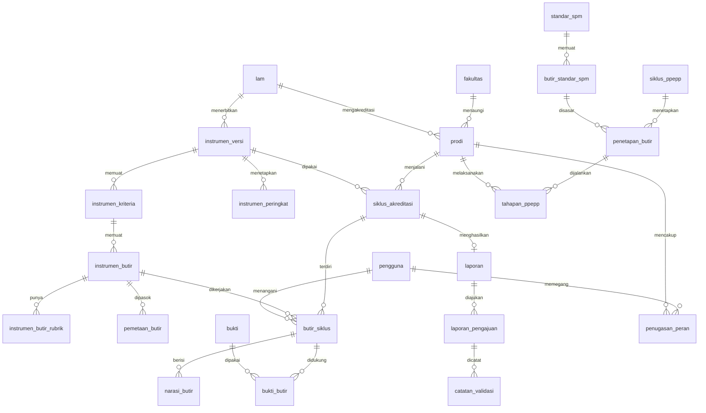

# SIMAK — Skema Basis Data

Dokumen 1 dari 3 · Arsitektur awal Sistem Informasi Manajemen Akreditasi
Rujukan: SKPL SIMAK v1.1, IAPS 3.1 LAMSAMA, IAPS 2.1 LAM INFOKOM

| | |
|---|---|
| **DBMS** | PostgreSQL 15 atau lebih baru (memakai `NULLS NOT DISTINCT`) |
| **Ekstensi** | `citext`, `pg_trgm` |
| **Ukuran** | 63 tabel, 2 view, 29 tipe enum, 152 foreign key |
| **Status uji** | `schema.sql` dan `seed.sql` dijalankan bersih di PostgreSQL 16; hasil uji di [bagian 7](#7-hasil-uji) |
| **Berkas** | `schema.sql` (DDL), `seed.sql` (data awal rujukan) |

`schema.sql` adalah rujukan desain. Dalam proyek, perubahan skema dikelola lewat migrasi Alembic yang dihasilkan dari model SQLAlchemy.

---

## 1. Peta tabel per domain

| # | Domain | Tabel | Rujukan SKPL |
|---|---|---|---|
| 1 | Organisasi & referensi | `fakultas`, `lam`, `prodi`, `tahun_akademik` | §2.3 |
| 2 | Identitas, peran, audit | `pengguna`, `penugasan_peran`, `token_refresh`, `token_akun`, `log_audit` | §3, US-A1, US-A2, US-G2 |
| 3 | Instrumen & Mapping Engine | `instrumen_versi`, `instrumen_kriteria`, `instrumen_butir`, `instrumen_butir_rubrik`, `instrumen_peringkat`, `instrumen_butir_ambang`, `instrumen_butir_padanan`, `indikator_inti`, `pemetaan_butir`, `nilai_indikator` | §2.2, US-D1, US-D3, US-F2, US-F4, US-G5, EC-14, EC-20, EC-31 |
| 4 | Siklus akreditasi & pengerjaan butir | `siklus_akreditasi`, `butir_siklus`, `narasi_butir`, `telaah_asesor`, `simulasi_skor` | US-B4, US-G3, US-H1, US-F4, EC-27, EC-29 |
| 5 | Laporan, validasi, ekspor | `laporan`, `laporan_pengajuan`, `catatan_validasi`, `ekspor_dokumen` | US-F3, US-D2, EC-06 s.d. EC-09 |
| 6 | Penjaminan mutu (PPEPP) | `standar_spm`, `butir_standar_spm`, `butir_standar_instrumen`, `siklus_ppepp`, `penetapan_butir`, `tahapan_ppepp` | US-C1, US-C2, US-C3, EC-22 |
| 7 | Data inti Tridharma | `dosen`, `dosen_prodi`, `mahasiswa_statistik`, `lulusan_statistik`, `kurikulum`, `mata_kuliah`, `kegiatan_tridharma`, `kegiatan_dosen`, `kegiatan_prodi`, `publikasi`, `publikasi_dosen`, `publikasi_prodi`, `kerja_sama`, `kerja_sama_prodi`, `sarana_prasarana`, `sarana_prodi`, `keuangan` | US-B1, US-B2, EC-01 s.d. EC-05 |
| 8 | Bukti | `bukti`, `bukti_prodi`, `bukti_butir`, `bukti_data_inti`, `bukti_tahapan_ppepp` | US-B3, EC-18, EC-23 |
| 9 | Dokumen eksternal | `dokumen_eksternal`, `dokumen_eksternal_prodi`, `indikator_eksternal` | Epik E, EC-15 s.d. EC-17 |
| 10 | LLM | `konfigurasi_llm`, `permintaan_llm` | US-D4, US-G4, EC-24 |
| 11 | Notifikasi & pengaturan | `notifikasi`, `pengaturan_sistem` | US-F3, US-A1 |

---

## 2. Keputusan desain utama

### 2.1 Satu model untuk dua instrumen yang cara menilainya berbeda

Kedua instrumen sama-sama memakai rubrik empat tingkat, tetapi cara menentukan status akreditasinya berbeda. Skema menampung keduanya tanpa tabel khusus per LAM.

| Aspek | IAPS 3.1 LAMSAMA | IAPS 2.1 LAM INFOKOM | Disimpan di |
|---|---|---|---|
| Susunan | 6 kriteria (A–F), 35 indikator | Bagian A, B, 6 kriteria, dan Suplemen | `instrumen_kriteria`, `instrumen_butir` |
| Rubrik | Baik Sekali, Baik, Cukup, Kurang | Sangat Baik = 4 s.d. Kurang = 1 | `instrumen_butir_rubrik`, `instrumen_versi.label_skor` |
| Bobot | Tidak ada | Tiap butir berbobot, total 400 | `instrumen_butir.bobot`, `instrumen_kriteria.bobot` (boleh `NULL`) |
| Penanda butir | Tidak ada | Input / Proses / Output dan tahap PPEPP | `instrumen_butir.jenis_ipo`, `instrumen_butir.tahap_ppepp` (boleh `NULL`) |
| Penentuan status | Tingkat minimum per indikator untuk tiap peringkat, ditambah syarat perlu | Rentang nilai akhir, ditambah syarat rerata kriteria dan skor minimum butir | `instrumen_butir_ambang` (LAMSAMA), `instrumen_peringkat.nilai_akhir_*` dan `.syarat` (LAM INFOKOM) |
| Peringkat | Unggul 5 tahun, Unggul 2 tahun, Terakreditasi, Tidak Terakreditasi | Unggul 5 tahun, Unggul 3 tahun, Terakreditasi, Tidak Terakreditasi | `instrumen_peringkat` |

Aturan LAM INFOKOM yang tersimpan di `instrumen_peringkat` (lihat `seed.sql`): nilai akhir di bawah 200 tidak terakreditasi; 200 sampai di bawah 321 terakreditasi; 321 sampai di bawah 361 Unggul 3 tahun; 361 ke atas Unggul 5 tahun. Kedua peringkat Unggul mensyaratkan rerata kriteria Budaya Mutu, Relevansi Pendidikan, dan Relevansi Penelitian masing-masing minimal 3,20 dengan skor butir minimal 3,00.

Menambah LAM ketiga cukup dengan mengisi baris baru di tabel-tabel ini.

### 2.2 Satu sumber kebenaran: pemetaan berupa aturan

`pemetaan_butir` menyimpan aturan "butir X dipasok oleh entitas Y dengan saringan Z". Data inti tidak pernah disalin ke butir. Saat butir dibuka, Mapping Engine menjalankan aturan itu terhadap tabel data inti, sehingga perubahan satu data langsung tercermin di semua butir yang merujuknya (EC-05), di kedua instrumen.

Aturan pemetaan disusun Staf Admin Fakultas sebagai draf dan baru berlaku setelah disetujui Dekan. Perubahan atas aturan yang sudah berlaku dibuat sebagai baris baru yang menunjuk aturan lama lewat `menggantikan_id`; aturan lama tetap dipakai sampai penggantinya disetujui (EC-31). Versi instrumen mengikuti pola yang sama: berstatus `draf` sampai Dekan menyetujuinya.

Perbandingan antarprodi yang berbeda instrumen memakai `indikator_inti` dan `nilai_indikator` (misalnya rasio mahasiswa per dosen), tidak membandingkan skor mentah lintas LAM (EC-20).

### 2.3 Peran adalah penugasan bercakupan dan berjangka

`penugasan_peran` menyimpan satu baris per peran, lengkap dengan cakupan prodi dan masa berlaku. Akibatnya:

- Jendela asesmen asesor adalah `berlaku_mulai` sampai `berlaku_sampai`. Akses diperiksa pada setiap permintaan, jadi berakhir sendiri tanpa tugas terjadwal.
- Usulan asesor dari Kaprodi berstatus `diusulkan`; Dekan mengubahnya menjadi `aktif`.
- Batasan basis data menolak Kaprodi tanpa prodi, Dekan dengan prodi, asesor aktif tanpa jendela, dan dua Kaprodi aktif pada satu prodi.

Pemetaan butir ke Staf Prodi atau Staf Fakultas (US-G3) disimpan di `butir_siklus.pengelola` dan `butir_siklus.penanggung_jawab_id`. Butir tanpa penanggung jawab adalah antrean "Belum Ditugaskan" (EC-27).

### 2.4 Siklus mengunci versi instrumen

`siklus_akreditasi.instrumen_versi_id` membuat draf yang sedang berjalan tetap pada versi instrumen saat siklus dibuka. Migrasi ke versi baru memakai `instrumen_butir_padanan` untuk memindahkan `butir_siklus` beserta narasinya ke butir padanannya (EC-14).

### 2.5 Monitoring berjalan, bukan hanya laporan final

`butir_siklus.status_kelengkapan` (`belum_mulai`, `draft`, `lengkap`) dapat disimpan kapan saja tanpa syarat kelengkapan (US-B4). View `v_kesiapan_siklus` menghitung persentase kesiapan, jumlah butir draf, butir tanpa penanggung jawab, butir yang menunggu dokumen eksternal, dan butir dengan bukti bermasalah. Pemeriksaan kelengkapan hanya dilakukan saat laporan diajukan.

### 2.6 Bukti: berkas atau tautan

Satu tabel `bukti` menampung keduanya; batasan `ck_bukti_jenis` memastikan berkas punya `objek_key` MinIO dan tautan punya `url`. Kolom `status_cek`, `kode_http`, `dicek_pada`, dan `gagal_beruntun` diisi link-checker. View `v_butir_bukti_bermasalah` menjadi dasar tanda merah dan pemblokiran validasi final (EC-23).

### 2.7 Asesor membaca versi yang disetujui

Asesor tidak membaca lembar kerja yang sedang berjalan. Sumbernya adalah cuplikan pada `laporan_pengajuan` yang berkeputusan `disetujui`, sehingga:

- pengajuan tidak dapat disetujui tanpa cuplikan (`ck_pengajuan_cuplikan`);
- `telaah_asesor.pengajuan_id` mencatat versi mana yang ditelaah;
- bila laporan dibuka kembali, asesor tetap melihat versi terakhir yang disetujui (EC-29);
- berkas bukti yang dirujuk cuplikan tidak dihapus fisik, karena `bukti` memakai hapus lunak.

### 2.8 Konvensi

| Hal | Aturan |
|---|---|
| Penamaan | Kosakata domain berbahasa Indonesia mengikuti SKPL; kolom teknis berbahasa Inggris |
| Kunci utama | `uuid` dengan `gen_random_uuid()`; `log_audit` memakai `bigint` identitas |
| Status alur kerja | Tipe `ENUM` |
| Kategori data | `text` dengan `CHECK`, supaya mudah diubah ketika nomenklatur LAM berubah |
| Penguncian optimistik | Kolom `row_version`, dinaikkan ORM pada setiap `UPDATE` (EC-10) |
| Hapus lunak | Kolom `deleted_at` pada data inti dan bukti |
| `updated_at` | Diisi trigger `set_updated_at()` pada 32 tabel |
| Hibah | Disimpan sebagai atribut pendanaan pada `kegiatan_tridharma` (`sumber_dana`, `jumlah_dana`, `nama_pemberi_dana`) |
| Penelitian dan PkM | Satu tabel `kegiatan_tridharma` dengan kolom `jenis`, karena bentuk datanya sama |

---

## 3. Diagram relasi (tabel inti)



Tabel data inti (domain 7) terhubung ke `prodi` lewat tabel atribusi (`dosen_prodi`, `kegiatan_prodi`, `publikasi_prodi`, `kerja_sama_prodi`, `sarana_prodi`) dan ke `tahun_akademik`.

---

## 4. DDL lengkap

```sql
-- =====================================================================
-- SIMAK — Sistem Informasi Manajemen Akreditasi
-- Skema basis data PostgreSQL (minimal versi 15; diuji pada versi 16)
--
-- Konvensi:
--   * Kosakata domain berbahasa Indonesia mengikuti SKPL; kolom teknis
--     (id, created_at, updated_at, row_version, ...) berbahasa Inggris.
--   * Primary key uuid; waktu selalu timestamptz.
--   * Status alur kerja memakai ENUM; kategori data memakai text + CHECK
--     agar mudah diubah saat nomenklatur LAM berubah.
--   * row_version = penguncian optimistik (EC-10), dinaikkan oleh ORM.
--   * deleted_at  = hapus lunak pada data inti dan bukti.
-- =====================================================================

CREATE EXTENSION IF NOT EXISTS citext;     -- email tidak peka huruf besar/kecil
CREATE EXTENSION IF NOT EXISTS pg_trgm;    -- kemiripan judul untuk deteksi duplikasi

-- ---------------------------------------------------------------------
-- 0. TIPE ENUM (status alur kerja)
-- ---------------------------------------------------------------------
CREATE TYPE peran_pengguna       AS ENUM ('dekan','kaprodi','staf_prodi','staf_fakultas','asesor','admin_it');
CREATE TYPE status_pengguna      AS ENUM ('aktif','nonaktif');
CREATE TYPE status_penugasan     AS ENUM ('diusulkan','aktif','dicabut');
CREATE TYPE jenis_token_akun     AS ENUM ('reset_sandi','buka_kunci');
CREATE TYPE status_instrumen     AS ENUM ('draf','aktif','arsip');
CREATE TYPE jenis_ipo            AS ENUM ('input','proses','output');
CREATE TYPE tahap_ppepp          AS ENUM ('penetapan','pelaksanaan','evaluasi','pengendalian','peningkatan');
CREATE TYPE jenis_penilaian      AS ENUM ('kualitatif','kuantitatif');
CREATE TYPE jenis_entitas        AS ENUM ('dosen','mahasiswa_statistik','lulusan_statistik','kurikulum',
                                          'mata_kuliah','penelitian','pkm','publikasi','kerja_sama',
                                          'sarana_prasarana','keuangan','indikator_eksternal','tahapan_ppepp');
CREATE TYPE status_siklus        AS ENUM ('persiapan','berjalan','selesai','arsip');
CREATE TYPE status_kelengkapan   AS ENUM ('belum_mulai','draft','lengkap');
CREATE TYPE pengelola_butir      AS ENUM ('prodi','fakultas');
CREATE TYPE sumber_skor          AS ENUM ('mandiri','sistem');
CREATE TYPE status_narasi        AS ENUM ('draft','final');
CREATE TYPE sumber_narasi        AS ENUM ('manual','llm','llm_disunting');
CREATE TYPE status_laporan       AS ENUM ('draft','menunggu_validasi','disetujui');
CREATE TYPE keputusan_validasi   AS ENUM ('menunggu','disetujui','dikembalikan');
CREATE TYPE status_catatan       AS ENUM ('terbuka','selesai');
CREATE TYPE status_tugas         AS ENUM ('antre','diproses','selesai','gagal');
CREATE TYPE jenis_ekspor         AS ENUM ('led','data_kuantitatif','gap_analysis');
CREATE TYPE format_ekspor        AS ENUM ('pdf','docx','xlsx');
CREATE TYPE status_siklus_ppepp  AS ENUM ('draf','ditetapkan','berjalan','selesai');
CREATE TYPE status_penetapan     AS ENUM ('draf','ditetapkan','dibatalkan');
CREATE TYPE status_tahapan       AS ENUM ('belum_mulai','berjalan','selesai');
CREATE TYPE status_data          AS ENUM ('draft','terverifikasi');
CREATE TYPE jenis_bukti          AS ENUM ('berkas','tautan');
CREATE TYPE akses_tautan         AS ENUM ('publik','terbatas');
CREATE TYPE status_cek_bukti     AS ENUM ('belum_dicek','ok','tidak_terjangkau');
CREATE TYPE mode_llm             AS ENUM ('offline','online');

CREATE FUNCTION set_updated_at() RETURNS trigger
LANGUAGE plpgsql AS $$
BEGIN
  NEW.updated_at := now();
  RETURN NEW;
END $$;

-- ---------------------------------------------------------------------
-- 1. ORGANISASI & REFERENSI
-- ---------------------------------------------------------------------
CREATE TABLE fakultas (
  id          uuid PRIMARY KEY DEFAULT gen_random_uuid(),
  kode        text NOT NULL UNIQUE,
  nama        text NOT NULL,
  created_at  timestamptz NOT NULL DEFAULT now(),
  updated_at  timestamptz NOT NULL DEFAULT now()
);

CREATE TABLE lam (
  id    uuid PRIMARY KEY DEFAULT gen_random_uuid(),
  kode  text NOT NULL UNIQUE,                      -- 'LAMSAMA', 'LAM_INFOKOM'
  nama  text NOT NULL
);

CREATE TABLE prodi (
  id           uuid PRIMARY KEY DEFAULT gen_random_uuid(),
  fakultas_id  uuid NOT NULL REFERENCES fakultas(id),
  lam_id       uuid NOT NULL REFERENCES lam(id),   -- menentukan instrumen secara otomatis (US-A1)
  kode         text NOT NULL UNIQUE,
  nama         text NOT NULL,
  jenjang      text NOT NULL DEFAULT 'S1',
  is_aktif     boolean NOT NULL DEFAULT true,
  created_at   timestamptz NOT NULL DEFAULT now(),
  updated_at   timestamptz NOT NULL DEFAULT now()
);

CREATE TABLE tahun_akademik (
  id               uuid PRIMARY KEY DEFAULT gen_random_uuid(),
  kode             text NOT NULL UNIQUE,           -- '2025/2026'
  tanggal_mulai    date NOT NULL,
  tanggal_selesai  date NOT NULL,
  is_aktif         boolean NOT NULL DEFAULT false,
  CONSTRAINT ck_tahun_akademik_rentang CHECK (tanggal_selesai > tanggal_mulai)
);
CREATE UNIQUE INDEX uq_tahun_akademik_aktif ON tahun_akademik (is_aktif) WHERE is_aktif;

-- ---------------------------------------------------------------------
-- 2. IDENTITAS, PERAN & AUDIT
-- ---------------------------------------------------------------------
CREATE TABLE pengguna (
  id                  uuid PRIMARY KEY DEFAULT gen_random_uuid(),
  email               citext NOT NULL UNIQUE,
  nama                text NOT NULL,
  password_hash       text NOT NULL,
  status              status_pengguna NOT NULL DEFAULT 'aktif',
  wajib_ganti_sandi   boolean NOT NULL DEFAULT true,
  jumlah_gagal_login  smallint NOT NULL DEFAULT 0 CHECK (jumlah_gagal_login >= 0),
  terkunci_sampai     timestamptz,                 -- terisi setelah 5x gagal; lewat waktu = terbuka otomatis
  login_terakhir      timestamptz,
  created_at          timestamptz NOT NULL DEFAULT now(),
  updated_at          timestamptz NOT NULL DEFAULT now()
);

-- Satu baris = satu peran dengan cakupannya. Jendela asesmen asesor = berlaku_mulai..berlaku_sampai.
CREATE TABLE penugasan_peran (
  id              uuid PRIMARY KEY DEFAULT gen_random_uuid(),
  pengguna_id     uuid NOT NULL REFERENCES pengguna(id) ON DELETE CASCADE,
  peran           peran_pengguna NOT NULL,
  prodi_id        uuid REFERENCES prodi(id),       -- wajib untuk kaprodi, staf_prodi, asesor
  status          status_penugasan NOT NULL DEFAULT 'aktif',
  berlaku_mulai   timestamptz,
  berlaku_sampai  timestamptz,
  diusulkan_oleh  uuid REFERENCES pengguna(id),    -- Kaprodi boleh mengusulkan asesor
  disetujui_oleh  uuid REFERENCES pengguna(id),    -- Dekan
  disetujui_pada  timestamptz,
  dicabut_oleh    uuid REFERENCES pengguna(id),
  dicabut_pada    timestamptz,
  catatan         text,
  created_at      timestamptz NOT NULL DEFAULT now(),
  updated_at      timestamptz NOT NULL DEFAULT now(),
  CONSTRAINT ck_penugasan_cakupan CHECK ((peran IN ('kaprodi','staf_prodi','asesor')) = (prodi_id IS NOT NULL)),
  CONSTRAINT ck_penugasan_rentang CHECK (berlaku_mulai IS NULL OR berlaku_sampai IS NULL OR berlaku_sampai > berlaku_mulai),
  CONSTRAINT ck_penugasan_asesor  CHECK (peran <> 'asesor' OR status <> 'aktif'
                                         OR (berlaku_mulai IS NOT NULL AND berlaku_sampai IS NOT NULL))
);
CREATE UNIQUE INDEX uq_penugasan_aktif ON penugasan_peran (pengguna_id, peran, prodi_id) NULLS NOT DISTINCT WHERE status = 'aktif';
CREATE UNIQUE INDEX uq_kaprodi_aktif   ON penugasan_peran (prodi_id) WHERE peran = 'kaprodi' AND status = 'aktif';
CREATE INDEX idx_penugasan_prodi       ON penugasan_peran (prodi_id, peran) WHERE status = 'aktif';

CREATE TABLE token_refresh (
  id                uuid PRIMARY KEY DEFAULT gen_random_uuid(),
  pengguna_id       uuid NOT NULL REFERENCES pengguna(id) ON DELETE CASCADE,
  token_hash        text NOT NULL UNIQUE,          -- hanya hash yang disimpan
  kedaluwarsa_pada  timestamptz NOT NULL,
  dicabut_pada      timestamptz,
  ip                inet,
  user_agent        text,
  created_at        timestamptz NOT NULL DEFAULT now()
);
CREATE INDEX idx_token_refresh_pengguna ON token_refresh (pengguna_id) WHERE dicabut_pada IS NULL;

CREATE TABLE token_akun (
  id                uuid PRIMARY KEY DEFAULT gen_random_uuid(),
  pengguna_id       uuid NOT NULL REFERENCES pengguna(id) ON DELETE CASCADE,
  jenis             jenis_token_akun NOT NULL,
  token_hash        text NOT NULL UNIQUE,
  kedaluwarsa_pada  timestamptz NOT NULL,
  dipakai_pada      timestamptz,
  dibuat_oleh       uuid REFERENCES pengguna(id),  -- NULL = swalayan; terisi = dipicu Admin IT
  created_at        timestamptz NOT NULL DEFAULT now()
);
CREATE INDEX idx_token_akun_pengguna ON token_akun (pengguna_id, jenis) WHERE dipakai_pada IS NULL;

-- Hanya-tambah (append-only): cabut hak UPDATE/DELETE dari peran aplikasi.
CREATE TABLE log_audit (
  id           bigint GENERATED ALWAYS AS IDENTITY PRIMARY KEY,
  waktu        timestamptz NOT NULL DEFAULT now(),
  pengguna_id  uuid REFERENCES pengguna(id) ON DELETE SET NULL,
  peran        peran_pengguna,
  aksi         text NOT NULL,                      -- 'login.gagal', 'akses.ditolak', 'laporan.setujui', ...
  entitas      text,
  entitas_id   uuid,
  prodi_id     uuid REFERENCES prodi(id),
  ip           inet,
  user_agent   text,
  detail       jsonb NOT NULL DEFAULT '{}'::jsonb  -- nilai sebelum/sesudah, alasan penolakan, dsb.
);
CREATE INDEX idx_log_audit_waktu    ON log_audit (waktu DESC);
CREATE INDEX idx_log_audit_pengguna ON log_audit (pengguna_id, waktu DESC);
CREATE INDEX idx_log_audit_entitas  ON log_audit (entitas, entitas_id);
CREATE INDEX idx_log_audit_aksi     ON log_audit (aksi, waktu DESC);

-- ---------------------------------------------------------------------
-- 3. INSTRUMEN AKREDITASI & MAPPING ENGINE (berbasis konfigurasi)
-- ---------------------------------------------------------------------
CREATE TABLE instrumen_versi (
  id                uuid PRIMARY KEY DEFAULT gen_random_uuid(),
  lam_id            uuid NOT NULL REFERENCES lam(id),
  kode_versi        text NOT NULL,                 -- '3.1' (LAMSAMA), '2.1' (LAM INFOKOM)
  nama              text NOT NULL,
  jenjang           text NOT NULL DEFAULT 'S1',
  dasar_hukum       text,
  berlaku_mulai     date,
  status            status_instrumen NOT NULL DEFAULT 'draf',
  skor_maks         smallint NOT NULL DEFAULT 4,
  label_skor        jsonb NOT NULL DEFAULT '{}'::jsonb,   -- {"4":"Baik Sekali","3":"Baik",...}
  nilai_akhir_maks  numeric(7,2),                  -- 400 pada LAM INFOKOM; NULL bila tanpa nilai akhir berbobot
  disusun_oleh      uuid REFERENCES pengguna(id),  -- Staf Admin Fakultas
  disetujui_oleh    uuid REFERENCES pengguna(id),  -- Dekan
  disetujui_pada    timestamptz,
  created_at        timestamptz NOT NULL DEFAULT now(),
  updated_at        timestamptz NOT NULL DEFAULT now(),
  UNIQUE (lam_id, jenjang, kode_versi),
  CONSTRAINT ck_instrumen_aktif_disetujui CHECK (status <> 'aktif' OR disetujui_oleh IS NOT NULL)
);

CREATE TABLE instrumen_kriteria (
  id                  uuid PRIMARY KEY DEFAULT gen_random_uuid(),
  instrumen_versi_id  uuid NOT NULL REFERENCES instrumen_versi(id) ON DELETE CASCADE,
  kode                text NOT NULL,               -- 'A'..'F' atau 'A','B','1'..'6','S'
  nama                text NOT NULL,
  bobot               numeric(7,2),                -- NULL bila instrumen tidak berbobot
  urutan              smallint NOT NULL,
  UNIQUE (instrumen_versi_id, kode),
  UNIQUE (id, instrumen_versi_id)
);

CREATE TABLE instrumen_butir (
  id                  uuid PRIMARY KEY DEFAULT gen_random_uuid(),
  instrumen_versi_id  uuid NOT NULL REFERENCES instrumen_versi(id) ON DELETE CASCADE,
  kriteria_id         uuid NOT NULL,
  kode                text NOT NULL,               -- '3' (LAMSAMA) atau '2.2.D' (LAM INFOKOM)
  nomor_urut          smallint NOT NULL,
  elemen              text NOT NULL,               -- indikator / elemen penilaian
  deskriptor          text,
  jenis_ipo           jenis_ipo,                   -- khusus instrumen yang membedakan I/P/O
  tahap_ppepp         tahap_ppepp,                 -- khusus instrumen yang menyusun butir per tahap PPEPP
  jenis_penilaian     jenis_penilaian NOT NULL DEFAULT 'kualitatif',
  bobot               numeric(7,2),
  rumus               jsonb,                       -- definisi hitung skor butir kuantitatif
  skema_narasi        jsonb NOT NULL DEFAULT '[]'::jsonb,  -- bagian form naratif khas instrumen (US-D3)
  panduan             text,
  created_at          timestamptz NOT NULL DEFAULT now(),
  updated_at          timestamptz NOT NULL DEFAULT now(),
  UNIQUE (instrumen_versi_id, kode),
  CONSTRAINT fk_butir_kriteria_seversi
    FOREIGN KEY (kriteria_id, instrumen_versi_id) REFERENCES instrumen_kriteria (id, instrumen_versi_id)
);
CREATE INDEX idx_instrumen_butir_kriteria ON instrumen_butir (kriteria_id, nomor_urut);

CREATE TABLE instrumen_butir_rubrik (
  instrumen_butir_id  uuid NOT NULL REFERENCES instrumen_butir(id) ON DELETE CASCADE,
  skor                smallint NOT NULL CHECK (skor BETWEEN 0 AND 4),
  deskriptor          text NOT NULL,
  PRIMARY KEY (instrumen_butir_id, skor)
);

-- Peringkat yang dapat dicapai + aturan tingkat instrumen (rentang nilai akhir, syarat rerata kriteria).
CREATE TABLE instrumen_peringkat (
  id                  uuid PRIMARY KEY DEFAULT gen_random_uuid(),
  instrumen_versi_id  uuid NOT NULL REFERENCES instrumen_versi(id) ON DELETE CASCADE,
  kode                text NOT NULL,               -- 'unggul_5', 'unggul_3', 'terakreditasi', ...
  nama                text NOT NULL,
  tingkat             smallint NOT NULL,           -- makin besar makin tinggi
  masa_berlaku_tahun  smallint,
  nilai_akhir_min     numeric(7,2),                -- inklusif
  nilai_akhir_maks    numeric(7,2),                -- eksklusif
  syarat              jsonb NOT NULL DEFAULT '{}'::jsonb,
  UNIQUE (instrumen_versi_id, kode),
  UNIQUE (instrumen_versi_id, tingkat)
);

-- Ambang minimum per butir untuk tiap peringkat (pola LAMSAMA: kriteria minimum + syarat perlu).
CREATE TABLE instrumen_butir_ambang (
  instrumen_butir_id  uuid NOT NULL REFERENCES instrumen_butir(id) ON DELETE CASCADE,
  peringkat_id        uuid NOT NULL REFERENCES instrumen_peringkat(id) ON DELETE CASCADE,
  skor_min            numeric(3,2) NOT NULL CHECK (skor_min BETWEEN 0 AND 4),
  is_syarat_perlu     boolean NOT NULL DEFAULT false,
  PRIMARY KEY (instrumen_butir_id, peringkat_id)
);

-- Padanan butir antarversi instrumen: dasar "Migrasi ke Versi Baru" tanpa kehilangan narasi (EC-14).
CREATE TABLE instrumen_butir_padanan (
  butir_lama_id  uuid NOT NULL REFERENCES instrumen_butir(id) ON DELETE CASCADE,
  butir_baru_id  uuid NOT NULL REFERENCES instrumen_butir(id) ON DELETE CASCADE,
  catatan        text,
  PRIMARY KEY (butir_lama_id, butir_baru_id),
  CONSTRAINT ck_padanan_beda CHECK (butir_lama_id <> butir_baru_id)
);

-- Indikator inti lintas instrumen: dasar benchmarking yang setara (US-F2, EC-20).
CREATE TABLE indikator_inti (
  id          uuid PRIMARY KEY DEFAULT gen_random_uuid(),
  kode        text NOT NULL UNIQUE,                -- 'rasio_mahasiswa_dosen', 'publikasi_per_dosen', ...
  nama        text NOT NULL,
  satuan      text,
  deskripsi   text,
  rumus       jsonb NOT NULL DEFAULT '{}'::jsonb,
  makin_tinggi_makin_baik boolean NOT NULL DEFAULT true
);

-- Mapping Engine: aturan "butir X dipasok oleh entitas Y dengan saringan Z". Tidak ada salinan data.
-- Disusun Staf Admin Fakultas sebagai draf (is_aktif = false); berlaku setelah disetujui Dekan.
-- Perubahan dibuat sebagai baris baru yang menunjuk aturan lama lewat menggantikan_id (EC-31).
CREATE TABLE pemetaan_butir (
  id                  uuid PRIMARY KEY DEFAULT gen_random_uuid(),
  instrumen_butir_id  uuid NOT NULL REFERENCES instrumen_butir(id) ON DELETE CASCADE,
  sumber              jenis_entitas NOT NULL,
  indikator_inti_id   uuid REFERENCES indikator_inti(id),
  aturan              jsonb NOT NULL DEFAULT '{}'::jsonb,  -- saringan, agregasi, rentang TS
  keterangan          text,
  is_aktif            boolean NOT NULL DEFAULT false,
  menggantikan_id     uuid REFERENCES pemetaan_butir(id) ON DELETE SET NULL,
  disetujui_oleh      uuid REFERENCES pengguna(id),
  disetujui_pada      timestamptz,
  created_by          uuid REFERENCES pengguna(id),
  updated_by          uuid REFERENCES pengguna(id),
  created_at          timestamptz NOT NULL DEFAULT now(),
  updated_at          timestamptz NOT NULL DEFAULT now(),
  CONSTRAINT ck_pemetaan_aktif_disetujui CHECK (NOT is_aktif OR disetujui_oleh IS NOT NULL)
);
CREATE INDEX idx_pemetaan_butir  ON pemetaan_butir (instrumen_butir_id) WHERE is_aktif;
CREATE INDEX idx_pemetaan_sumber ON pemetaan_butir (sumber) WHERE is_aktif;

CREATE TABLE nilai_indikator (
  id                 uuid PRIMARY KEY DEFAULT gen_random_uuid(),
  indikator_inti_id  uuid NOT NULL REFERENCES indikator_inti(id) ON DELETE CASCADE,
  prodi_id           uuid NOT NULL REFERENCES prodi(id),
  tahun_akademik_id  uuid NOT NULL REFERENCES tahun_akademik(id),
  nilai              numeric(14,4),
  rincian            jsonb NOT NULL DEFAULT '{}'::jsonb,
  dihitung_pada      timestamptz NOT NULL DEFAULT now(),
  UNIQUE (indikator_inti_id, prodi_id, tahun_akademik_id)
);
CREATE INDEX idx_nilai_indikator_prodi ON nilai_indikator (prodi_id, tahun_akademik_id);

-- ---------------------------------------------------------------------
-- 4. SIKLUS AKREDITASI & PENGERJAAN BUTIR
-- ---------------------------------------------------------------------
-- Siklus mengunci versi instrumen: draf berjalan otomatis "beku" pada versi tersebut (EC-14).
CREATE TABLE siklus_akreditasi (
  id                    uuid PRIMARY KEY DEFAULT gen_random_uuid(),
  prodi_id              uuid NOT NULL REFERENCES prodi(id),
  instrumen_versi_id    uuid NOT NULL REFERENCES instrumen_versi(id),
  nama                  text NOT NULL,
  ts_tahun_akademik_id  uuid NOT NULL REFERENCES tahun_akademik(id),  -- TS; data dihitung TS-n..TS
  jumlah_tahun_data     smallint NOT NULL DEFAULT 3 CHECK (jumlah_tahun_data BETWEEN 1 AND 7),
  tanggal_mulai         date NOT NULL,
  tenggat               date,
  target_peringkat_id   uuid REFERENCES instrumen_peringkat(id),
  status                status_siklus NOT NULL DEFAULT 'persiapan',
  created_by            uuid REFERENCES pengguna(id),
  created_at            timestamptz NOT NULL DEFAULT now(),
  updated_at            timestamptz NOT NULL DEFAULT now(),
  CONSTRAINT ck_siklus_tenggat CHECK (tenggat IS NULL OR tenggat >= tanggal_mulai)
);
CREATE UNIQUE INDEX uq_siklus_berjalan ON siklus_akreditasi (prodi_id) WHERE status IN ('persiapan','berjalan');
CREATE INDEX idx_siklus_prodi ON siklus_akreditasi (prodi_id, status);

-- Lembar kerja satu butir instrumen dalam satu siklus: kelengkapan, penanggung jawab, skor estimasi.
CREATE TABLE butir_siklus (
  id                          uuid PRIMARY KEY DEFAULT gen_random_uuid(),
  siklus_id                   uuid NOT NULL REFERENCES siklus_akreditasi(id) ON DELETE CASCADE,
  instrumen_butir_id          uuid NOT NULL REFERENCES instrumen_butir(id),
  status_kelengkapan          status_kelengkapan NOT NULL DEFAULT 'belum_mulai',
  pengelola                   pengelola_butir NOT NULL DEFAULT 'prodi',  -- 'fakultas' = di luar kendali prodi
  penanggung_jawab_id         uuid REFERENCES pengguna(id),              -- NULL = belum ditugaskan (EC-27)
  ditugaskan_oleh             uuid REFERENCES pengguna(id),
  ditugaskan_pada             timestamptz,
  skor_estimasi               numeric(3,2) CHECK (skor_estimasi BETWEEN 0 AND 4),
  sumber_skor                 sumber_skor,
  skor_dihitung_pada          timestamptz,
  menunggu_dokumen_eksternal  boolean NOT NULL DEFAULT false,            -- EC-15
  catatan                     text,
  row_version                 integer NOT NULL DEFAULT 1,
  updated_by                  uuid REFERENCES pengguna(id),
  created_at                  timestamptz NOT NULL DEFAULT now(),
  updated_at                  timestamptz NOT NULL DEFAULT now(),
  UNIQUE (siklus_id, instrumen_butir_id)
);
CREATE INDEX idx_butir_siklus_status ON butir_siklus (siklus_id, status_kelengkapan);
CREATE INDEX idx_butir_siklus_pj     ON butir_siklus (penanggung_jawab_id, status_kelengkapan) WHERE penanggung_jawab_id IS NOT NULL;
CREATE INDEX idx_butir_siklus_tanpa_pj ON butir_siklus (siklus_id) WHERE penanggung_jawab_id IS NULL;

CREATE TABLE narasi_butir (
  id                 uuid PRIMARY KEY DEFAULT gen_random_uuid(),
  butir_siklus_id    uuid NOT NULL REFERENCES butir_siklus(id) ON DELETE CASCADE,
  bagian             text NOT NULL DEFAULT 'utama',   -- kunci bagian pada instrumen_butir.skema_narasi
  isi                text NOT NULL DEFAULT '',
  status             status_narasi NOT NULL DEFAULT 'draft',
  sumber             sumber_narasi NOT NULL DEFAULT 'manual',
  permintaan_llm_id  uuid,                            -- FK ditambahkan di bagian 10
  row_version        integer NOT NULL DEFAULT 1,
  updated_by         uuid REFERENCES pengguna(id),
  created_at         timestamptz NOT NULL DEFAULT now(),
  updated_at         timestamptz NOT NULL DEFAULT now(),
  UNIQUE (butir_siklus_id, bagian)
);

-- Tanda "sudah ditelaah" dan catatan baca asesor; tidak mengubah data sumber (US-H1).
-- Asesor membaca versi laporan yang disetujui, sehingga telaah terikat pada pengajuannya.
CREATE TABLE telaah_asesor (
  id               uuid PRIMARY KEY DEFAULT gen_random_uuid(),
  butir_siklus_id  uuid NOT NULL REFERENCES butir_siklus(id) ON DELETE CASCADE,
  asesor_id        uuid NOT NULL REFERENCES pengguna(id) ON DELETE CASCADE,
  pengajuan_id     uuid NOT NULL,                     -- versi yang ditelaah; FK ditambahkan di bagian 5
  sudah_ditelaah   boolean NOT NULL DEFAULT false,
  catatan          text,
  created_at       timestamptz NOT NULL DEFAULT now(),
  updated_at       timestamptz NOT NULL DEFAULT now(),
  UNIQUE (butir_siklus_id, asesor_id, pengajuan_id)
);
CREATE INDEX idx_telaah_asesor ON telaah_asesor (asesor_id);

-- Riwayat simulasi skor & prediksi peringkat; selalu berlabel estimasi internal (US-F4).
CREATE TABLE simulasi_skor (
  id                    uuid PRIMARY KEY DEFAULT gen_random_uuid(),
  siklus_id             uuid NOT NULL REFERENCES siklus_akreditasi(id) ON DELETE CASCADE,
  nilai_akhir           numeric(7,2),
  prediksi_peringkat_id uuid REFERENCES instrumen_peringkat(id),
  rincian               jsonb NOT NULL DEFAULT '{}'::jsonb,  -- per kriteria, butir di bawah ambang, syarat gagal
  dihitung_oleh         uuid REFERENCES pengguna(id),
  dihitung_pada         timestamptz NOT NULL DEFAULT now()
);
CREATE INDEX idx_simulasi_siklus ON simulasi_skor (siklus_id, dihitung_pada DESC);

-- ---------------------------------------------------------------------
-- 5. LAPORAN EVALUASI DIRI, VALIDASI & EKSPOR
-- ---------------------------------------------------------------------
CREATE TABLE laporan (
  id                    uuid PRIMARY KEY DEFAULT gen_random_uuid(),
  siklus_id             uuid NOT NULL UNIQUE REFERENCES siklus_akreditasi(id) ON DELETE CASCADE,
  status                status_laporan NOT NULL DEFAULT 'draft',
  dibuka_kembali_oleh   uuid REFERENCES pengguna(id),   -- reopen oleh Dekan (EC-09)
  dibuka_kembali_pada   timestamptz,
  row_version           integer NOT NULL DEFAULT 1,
  created_at            timestamptz NOT NULL DEFAULT now(),
  updated_at            timestamptz NOT NULL DEFAULT now()
);

-- Satu baris per kali submit. Cuplikan (snapshot) menjaga versi sebelumnya tidak hilang (EC-08).
-- Cuplikan pengajuan yang disetujui adalah versi yang dilihat asesor (EC-29).
CREATE TABLE laporan_pengajuan (
  id               uuid PRIMARY KEY DEFAULT gen_random_uuid(),
  laporan_id       uuid NOT NULL REFERENCES laporan(id) ON DELETE CASCADE,
  nomor            integer NOT NULL CHECK (nomor > 0),
  diajukan_oleh    uuid NOT NULL REFERENCES pengguna(id),
  diajukan_pada    timestamptz NOT NULL DEFAULT now(),
  keputusan        keputusan_validasi NOT NULL DEFAULT 'menunggu',
  diputuskan_oleh  uuid REFERENCES pengguna(id),
  diputuskan_pada  timestamptz,
  catatan_umum     text,
  cuplikan         jsonb,                              -- isi kecil; isi besar disimpan di MinIO
  cuplikan_objek_key text,
  UNIQUE (laporan_id, nomor),
  CONSTRAINT ck_pengajuan_keputusan CHECK ((keputusan = 'menunggu') = (diputuskan_oleh IS NULL)),
  CONSTRAINT ck_pengajuan_cuplikan  CHECK (keputusan <> 'disetujui' OR cuplikan IS NOT NULL OR cuplikan_objek_key IS NOT NULL)
);
CREATE UNIQUE INDEX uq_pengajuan_menunggu ON laporan_pengajuan (laporan_id) WHERE keputusan = 'menunggu';
CREATE INDEX idx_pengajuan_disetujui ON laporan_pengajuan (laporan_id, nomor DESC) WHERE keputusan = 'disetujui';

ALTER TABLE telaah_asesor
  ADD CONSTRAINT fk_telaah_pengajuan
  FOREIGN KEY (pengajuan_id) REFERENCES laporan_pengajuan(id) ON DELETE CASCADE;

CREATE TABLE catatan_validasi (
  id                 uuid PRIMARY KEY DEFAULT gen_random_uuid(),
  pengajuan_id       uuid NOT NULL REFERENCES laporan_pengajuan(id) ON DELETE CASCADE,
  butir_siklus_id    uuid REFERENCES butir_siklus(id) ON DELETE CASCADE,  -- NULL = catatan umum
  isi                text NOT NULL,
  status             status_catatan NOT NULL DEFAULT 'terbuka',
  dibuat_oleh        uuid NOT NULL REFERENCES pengguna(id),
  diselesaikan_oleh  uuid REFERENCES pengguna(id),
  diselesaikan_pada  timestamptz,
  created_at         timestamptz NOT NULL DEFAULT now()
);
CREATE INDEX idx_catatan_pengajuan ON catatan_validasi (pengajuan_id);
CREATE INDEX idx_catatan_butir     ON catatan_validasi (butir_siklus_id) WHERE status = 'terbuka';

CREATE TABLE ekspor_dokumen (
  id            uuid PRIMARY KEY DEFAULT gen_random_uuid(),
  siklus_id     uuid NOT NULL REFERENCES siklus_akreditasi(id) ON DELETE CASCADE,
  pengajuan_id  uuid REFERENCES laporan_pengajuan(id),  -- terisi untuk dokumen final
  jenis         jenis_ekspor NOT NULL,
  format        format_ekspor NOT NULL,
  status        status_tugas NOT NULL DEFAULT 'antre',
  objek_key     text,
  ukuran_byte   bigint,
  metadata      jsonb NOT NULL DEFAULT '{}'::jsonb,     -- tanggal, prodi, instrumen, versi data (US-D2)
  galat         text,
  task_id       text,
  diminta_oleh  uuid NOT NULL REFERENCES pengguna(id),
  created_at    timestamptz NOT NULL DEFAULT now(),
  selesai_pada  timestamptz
);
CREATE INDEX idx_ekspor_siklus ON ekspor_dokumen (siklus_id, created_at DESC);

-- ---------------------------------------------------------------------
-- 6. PENJAMINAN MUTU (PPEPP)
-- ---------------------------------------------------------------------
CREATE TABLE standar_spm (
  id               uuid PRIMARY KEY DEFAULT gen_random_uuid(),
  kode             text NOT NULL UNIQUE,
  nama             text NOT NULL,
  kategori         text,                               -- pendidikan, penelitian, pkm, tata kelola, ...
  dokumen_sumber   text,                               -- nomor/nama dokumen standar dari SPM
  versi            text,
  is_aktif         boolean NOT NULL DEFAULT true,
  divalidasi_oleh  uuid REFERENCES pengguna(id),       -- Dekan
  divalidasi_pada  timestamptz,
  created_by       uuid REFERENCES pengguna(id),
  created_at       timestamptz NOT NULL DEFAULT now(),
  updated_at       timestamptz NOT NULL DEFAULT now()
);

CREATE TABLE butir_standar_spm (
  id              uuid PRIMARY KEY DEFAULT gen_random_uuid(),
  standar_id      uuid NOT NULL REFERENCES standar_spm(id) ON DELETE CASCADE,
  nomor           text NOT NULL,
  pernyataan      text NOT NULL,
  indikator       text,
  target_default  text,
  satuan          text,
  is_aktif        boolean NOT NULL DEFAULT true,
  created_at      timestamptz NOT NULL DEFAULT now(),
  updated_at      timestamptz NOT NULL DEFAULT now(),
  UNIQUE (standar_id, nomor)
);

-- Kaitan butir standar SPM dengan butir instrumen LAM yang dipenuhinya.
CREATE TABLE butir_standar_instrumen (
  butir_standar_id    uuid NOT NULL REFERENCES butir_standar_spm(id) ON DELETE CASCADE,
  instrumen_butir_id  uuid NOT NULL REFERENCES instrumen_butir(id) ON DELETE CASCADE,
  PRIMARY KEY (butir_standar_id, instrumen_butir_id)
);
CREATE INDEX idx_standar_instrumen_butir ON butir_standar_instrumen (instrumen_butir_id);

CREATE TABLE siklus_ppepp (
  id                    uuid PRIMARY KEY DEFAULT gen_random_uuid(),
  nama                  text NOT NULL,
  tahun_akademik_id     uuid NOT NULL REFERENCES tahun_akademik(id),
  tanggal_mulai         date NOT NULL,
  tanggal_selesai       date,
  status                status_siklus_ppepp NOT NULL DEFAULT 'draf',
  siklus_sebelumnya_id  uuid REFERENCES siklus_ppepp(id),   -- sumber baseline (EC-22)
  ditetapkan_oleh       uuid REFERENCES pengguna(id),
  ditetapkan_pada       timestamptz,
  created_at            timestamptz NOT NULL DEFAULT now(),
  updated_at            timestamptz NOT NULL DEFAULT now(),
  CONSTRAINT ck_siklus_ppepp_rentang CHECK (tanggal_selesai IS NULL OR tanggal_selesai > tanggal_mulai)
);

-- P1 (Penetapan) oleh Dekan: butir sasaran, isi, indikator, target (US-C1).
CREATE TABLE penetapan_butir (
  id                   uuid PRIMARY KEY DEFAULT gen_random_uuid(),
  siklus_ppepp_id      uuid NOT NULL REFERENCES siklus_ppepp(id) ON DELETE CASCADE,
  butir_standar_id     uuid NOT NULL REFERENCES butir_standar_spm(id),
  prodi_id             uuid REFERENCES prodi(id),          -- NULL = berlaku untuk semua prodi
  nomor_butir          text NOT NULL,
  isi                  text NOT NULL,                      -- pernyataan standar sebagaimana ditetapkan
  indikator            text NOT NULL,
  target_nilai         numeric(14,4),
  target_satuan        text,
  target_deskripsi     text,
  periode_mulai        date,
  periode_selesai      date,
  penanggung_jawab_id  uuid REFERENCES pengguna(id),
  baseline_dari_id     uuid REFERENCES penetapan_butir(id),
  baseline_nilai       numeric(14,4),
  status               status_penetapan NOT NULL DEFAULT 'draf',
  ditetapkan_oleh      uuid REFERENCES pengguna(id),
  ditetapkan_pada      timestamptz,
  row_version          integer NOT NULL DEFAULT 1,
  created_at           timestamptz NOT NULL DEFAULT now(),
  updated_at           timestamptz NOT NULL DEFAULT now(),
  CONSTRAINT ck_penetapan_periode CHECK (periode_mulai IS NULL OR periode_selesai IS NULL OR periode_selesai >= periode_mulai),
  CONSTRAINT ck_penetapan_status  CHECK (status <> 'ditetapkan' OR ditetapkan_oleh IS NOT NULL)
);
CREATE UNIQUE INDEX uq_penetapan_butir ON penetapan_butir (siklus_ppepp_id, butir_standar_id, prodi_id) NULLS NOT DISTINCT
  WHERE status <> 'dibatalkan';
CREATE INDEX idx_penetapan_prodi ON penetapan_butir (prodi_id, status);

-- P2..P5 per prodi atas butir yang telah ditetapkan (US-C2).
CREATE TABLE tahapan_ppepp (
  id                  uuid PRIMARY KEY DEFAULT gen_random_uuid(),
  penetapan_butir_id  uuid NOT NULL REFERENCES penetapan_butir(id) ON DELETE CASCADE,
  prodi_id            uuid NOT NULL REFERENCES prodi(id),
  tahap               tahap_ppepp NOT NULL CHECK (tahap <> 'penetapan'),
  status              status_tahapan NOT NULL DEFAULT 'belum_mulai',
  uraian              text,
  capaian_nilai       numeric(14,4),
  capaian_deskripsi   text,
  temuan              text,                               -- diisi pada tahap evaluasi
  tindak_lanjut       text,                               -- diisi pada tahap pengendalian
  tenggat             date,
  row_version         integer NOT NULL DEFAULT 1,
  updated_by          uuid REFERENCES pengguna(id),
  created_at          timestamptz NOT NULL DEFAULT now(),
  updated_at          timestamptz NOT NULL DEFAULT now(),
  UNIQUE (penetapan_butir_id, prodi_id, tahap)
);
CREATE INDEX idx_tahapan_prodi ON tahapan_ppepp (prodi_id, status);

-- ---------------------------------------------------------------------
-- 7. DATA INTI TRIDHARMA (netral terhadap instrumen)
-- ---------------------------------------------------------------------
CREATE TABLE dosen (
  id                         uuid PRIMARY KEY DEFAULT gen_random_uuid(),
  nidn                       text,
  nuptk                      text,
  nama                       text NOT NULL,
  gelar_depan                text,
  gelar_belakang             text,
  jabatan_akademik           text CHECK (jabatan_akademik IN ('tenaga_pengajar','asisten_ahli','lektor','lektor_kepala','guru_besar')),
  pendidikan_tertinggi       text NOT NULL CHECK (pendidikan_tertinggi IN ('s1','s2','s3','profesi','spesialis')),
  bidang_keahlian            text,
  status_kepegawaian         text NOT NULL CHECK (status_kepegawaian IN ('tetap','tidak_tetap','praktisi')),
  punya_sertifikat_pendidik  boolean NOT NULL DEFAULT false,
  email                      citext,
  is_aktif                   boolean NOT NULL DEFAULT true,
  status_data                status_data NOT NULL DEFAULT 'draft',
  row_version                integer NOT NULL DEFAULT 1,
  created_by                 uuid REFERENCES pengguna(id),
  updated_by                 uuid REFERENCES pengguna(id),
  created_at                 timestamptz NOT NULL DEFAULT now(),
  updated_at                 timestamptz NOT NULL DEFAULT now(),
  deleted_at                 timestamptz
);
CREATE UNIQUE INDEX uq_dosen_nidn  ON dosen (nidn)  WHERE nidn  IS NOT NULL AND deleted_at IS NULL;
CREATE UNIQUE INDEX uq_dosen_nuptk ON dosen (nuptk) WHERE nuptk IS NOT NULL AND deleted_at IS NULL;
CREATE INDEX idx_dosen_nama_trgm ON dosen USING gin (nama gin_trgm_ops);

-- Afiliasi dosen per prodi per tahun; proporsi mencegah hitung ganda dosen lintas prodi (EC-01).
CREATE TABLE dosen_prodi (
  id                 uuid PRIMARY KEY DEFAULT gen_random_uuid(),
  dosen_id           uuid NOT NULL REFERENCES dosen(id) ON DELETE CASCADE,
  prodi_id           uuid NOT NULL REFERENCES prodi(id),
  tahun_akademik_id  uuid NOT NULL REFERENCES tahun_akademik(id),
  jenis              text NOT NULL CHECK (jenis IN ('homebase','pengampu')),
  proporsi_beban     numeric(4,3) NOT NULL DEFAULT 1 CHECK (proporsi_beban > 0 AND proporsi_beban <= 1),
  sks_diampu         numeric(5,2),
  UNIQUE (dosen_id, prodi_id, tahun_akademik_id)
);
CREATE UNIQUE INDEX uq_dosen_homebase ON dosen_prodi (dosen_id, tahun_akademik_id) WHERE jenis = 'homebase';
CREATE INDEX idx_dosen_prodi_prodi ON dosen_prodi (prodi_id, tahun_akademik_id);

CREATE TABLE mahasiswa_statistik (
  id                 uuid PRIMARY KEY DEFAULT gen_random_uuid(),
  prodi_id           uuid NOT NULL REFERENCES prodi(id),
  tahun_akademik_id  uuid NOT NULL REFERENCES tahun_akademik(id),
  daya_tampung       integer CHECK (daya_tampung >= 0),
  pendaftar          integer CHECK (pendaftar >= 0),
  lulus_seleksi      integer CHECK (lulus_seleksi >= 0),
  maba_reguler       integer CHECK (maba_reguler >= 0),
  maba_transfer      integer CHECK (maba_transfer >= 0),
  aktif_reguler      integer CHECK (aktif_reguler >= 0),
  aktif_transfer     integer CHECK (aktif_transfer >= 0),
  mahasiswa_asing    integer CHECK (mahasiswa_asing >= 0),
  status_data        status_data NOT NULL DEFAULT 'draft',
  row_version        integer NOT NULL DEFAULT 1,
  created_by         uuid REFERENCES pengguna(id),
  updated_by         uuid REFERENCES pengguna(id),
  created_at         timestamptz NOT NULL DEFAULT now(),
  updated_at         timestamptz NOT NULL DEFAULT now(),
  UNIQUE (prodi_id, tahun_akademik_id)
);

CREATE TABLE lulusan_statistik (
  id                     uuid PRIMARY KEY DEFAULT gen_random_uuid(),
  prodi_id               uuid NOT NULL REFERENCES prodi(id),
  tahun_akademik_id      uuid NOT NULL REFERENCES tahun_akademik(id),   -- tahun lulus
  jumlah_lulusan         integer CHECK (jumlah_lulusan >= 0),
  ipk_min                numeric(3,2) CHECK (ipk_min  BETWEEN 0 AND 4),
  ipk_rata               numeric(3,2) CHECK (ipk_rata BETWEEN 0 AND 4),
  ipk_maks               numeric(3,2) CHECK (ipk_maks BETWEEN 0 AND 4),
  masa_studi_rata_tahun  numeric(4,2) CHECK (masa_studi_rata_tahun > 0),
  lulus_tepat_waktu      integer CHECK (lulus_tepat_waktu >= 0),
  status_data            status_data NOT NULL DEFAULT 'draft',
  row_version            integer NOT NULL DEFAULT 1,
  created_by             uuid REFERENCES pengguna(id),
  updated_by             uuid REFERENCES pengguna(id),
  created_at             timestamptz NOT NULL DEFAULT now(),
  updated_at             timestamptz NOT NULL DEFAULT now(),
  UNIQUE (prodi_id, tahun_akademik_id)
);

CREATE TABLE kurikulum (
  id             uuid PRIMARY KEY DEFAULT gen_random_uuid(),
  prodi_id       uuid NOT NULL REFERENCES prodi(id),
  nama           text NOT NULL,
  tahun_berlaku  smallint NOT NULL,
  is_aktif       boolean NOT NULL DEFAULT true,
  status_data    status_data NOT NULL DEFAULT 'draft',
  row_version    integer NOT NULL DEFAULT 1,
  created_by     uuid REFERENCES pengguna(id),
  updated_by     uuid REFERENCES pengguna(id),
  created_at     timestamptz NOT NULL DEFAULT now(),
  updated_at     timestamptz NOT NULL DEFAULT now(),
  deleted_at     timestamptz
);
CREATE INDEX idx_kurikulum_prodi ON kurikulum (prodi_id) WHERE deleted_at IS NULL;

CREATE TABLE mata_kuliah (
  id            uuid PRIMARY KEY DEFAULT gen_random_uuid(),
  kurikulum_id  uuid NOT NULL REFERENCES kurikulum(id) ON DELETE CASCADE,
  kode          text NOT NULL,
  nama          text NOT NULL,
  sks           numeric(4,1) NOT NULL CHECK (sks > 0),
  semester      smallint CHECK (semester BETWEEN 1 AND 14),
  jenis         text NOT NULL DEFAULT 'wajib' CHECK (jenis IN ('wajib','pilihan')),
  ada_rps       boolean NOT NULL DEFAULT false,
  created_at    timestamptz NOT NULL DEFAULT now(),
  updated_at    timestamptz NOT NULL DEFAULT now(),
  UNIQUE (kurikulum_id, kode)
);

-- Penelitian dan PkM berbentuk sama, dibedakan kolom jenis. Hibah = atribut pendanaan kegiatan.
CREATE TABLE kegiatan_tridharma (
  id                    uuid PRIMARY KEY DEFAULT gen_random_uuid(),
  jenis                 text NOT NULL CHECK (jenis IN ('penelitian','pkm')),
  judul                 text NOT NULL,
  tahun_akademik_id     uuid NOT NULL REFERENCES tahun_akademik(id),
  sumber_dana           text NOT NULL CHECK (sumber_dana IN ('pt_mandiri','dalam_negeri','luar_negeri')),
  nama_pemberi_dana     text,
  nomor_kontrak         text,
  jumlah_dana           numeric(16,2) NOT NULL DEFAULT 0 CHECK (jumlah_dana >= 0),
  jumlah_mahasiswa      integer NOT NULL DEFAULT 0 CHECK (jumlah_mahasiswa >= 0),
  status_data           status_data NOT NULL DEFAULT 'draft',
  row_version           integer NOT NULL DEFAULT 1,
  created_by            uuid REFERENCES pengguna(id),
  updated_by            uuid REFERENCES pengguna(id),
  created_at            timestamptz NOT NULL DEFAULT now(),
  updated_at            timestamptz NOT NULL DEFAULT now(),
  deleted_at            timestamptz
);
CREATE INDEX idx_kegiatan_jenis_tahun ON kegiatan_tridharma (jenis, tahun_akademik_id) WHERE deleted_at IS NULL;
CREATE INDEX idx_kegiatan_judul_trgm  ON kegiatan_tridharma USING gin (judul gin_trgm_ops);

CREATE TABLE kegiatan_dosen (
  kegiatan_id  uuid NOT NULL REFERENCES kegiatan_tridharma(id) ON DELETE CASCADE,
  dosen_id     uuid NOT NULL REFERENCES dosen(id),
  peran        text NOT NULL DEFAULT 'anggota' CHECK (peran IN ('ketua','anggota')),
  PRIMARY KEY (kegiatan_id, dosen_id)
);
CREATE UNIQUE INDEX uq_kegiatan_ketua ON kegiatan_dosen (kegiatan_id) WHERE peran = 'ketua';
CREATE INDEX idx_kegiatan_dosen_dosen ON kegiatan_dosen (dosen_id);

-- Atribusi kegiatan ke prodi; jumlah proporsi per kegiatan dijaga <= 1 di lapisan layanan (EC-02).
CREATE TABLE kegiatan_prodi (
  kegiatan_id  uuid NOT NULL REFERENCES kegiatan_tridharma(id) ON DELETE CASCADE,
  prodi_id     uuid NOT NULL REFERENCES prodi(id),
  proporsi     numeric(4,3) NOT NULL DEFAULT 1 CHECK (proporsi > 0 AND proporsi <= 1),
  PRIMARY KEY (kegiatan_id, prodi_id)
);
CREATE INDEX idx_kegiatan_prodi_prodi ON kegiatan_prodi (prodi_id);

-- Publikasi dan luaran lain (termasuk HKI).
CREATE TABLE publikasi (
  id                 uuid PRIMARY KEY DEFAULT gen_random_uuid(),
  judul              text NOT NULL,
  jenis              text NOT NULL CHECK (jenis IN ('jurnal','prosiding','buku','bab_buku','paten','paten_sederhana',
                                                    'hak_cipta','desain_industri','teknologi_tepat_guna','lainnya')),
  tingkat            text CHECK (tingkat IN ('internasional_bereputasi','internasional','nasional_terakreditasi','nasional','lokal')),
  nama_media         text,                             -- jurnal, prosiding, penerbit
  tahun_terbit       smallint NOT NULL CHECK (tahun_terbit BETWEEN 1950 AND 2100),
  tahun_akademik_id  uuid NOT NULL REFERENCES tahun_akademik(id),
  doi                text,
  url                text,
  jumlah_sitasi      integer NOT NULL DEFAULT 0 CHECK (jumlah_sitasi >= 0),
  kegiatan_id        uuid REFERENCES kegiatan_tridharma(id) ON DELETE SET NULL,  -- luaran dari penelitian/PkM
  jumlah_mahasiswa   integer NOT NULL DEFAULT 0 CHECK (jumlah_mahasiswa >= 0),
  status_data        status_data NOT NULL DEFAULT 'draft',
  row_version        integer NOT NULL DEFAULT 1,
  created_by         uuid REFERENCES pengguna(id),
  updated_by         uuid REFERENCES pengguna(id),
  created_at         timestamptz NOT NULL DEFAULT now(),
  updated_at         timestamptz NOT NULL DEFAULT now(),
  deleted_at         timestamptz
);
CREATE UNIQUE INDEX uq_publikasi_doi      ON publikasi (lower(doi)) WHERE doi IS NOT NULL AND deleted_at IS NULL;  -- EC-03
CREATE INDEX idx_publikasi_judul_trgm     ON publikasi USING gin (judul gin_trgm_ops);
CREATE INDEX idx_publikasi_tahun          ON publikasi (tahun_akademik_id, jenis) WHERE deleted_at IS NULL;
CREATE INDEX idx_publikasi_kegiatan       ON publikasi (kegiatan_id) WHERE kegiatan_id IS NOT NULL;

CREATE TABLE publikasi_dosen (
  publikasi_id     uuid NOT NULL REFERENCES publikasi(id) ON DELETE CASCADE,
  dosen_id         uuid NOT NULL REFERENCES dosen(id),
  urutan_penulis   smallint NOT NULL CHECK (urutan_penulis > 0),
  is_korespondensi boolean NOT NULL DEFAULT false,
  PRIMARY KEY (publikasi_id, dosen_id)
);
CREATE INDEX idx_publikasi_dosen_dosen ON publikasi_dosen (dosen_id);

CREATE TABLE publikasi_prodi (
  publikasi_id  uuid NOT NULL REFERENCES publikasi(id) ON DELETE CASCADE,
  prodi_id      uuid NOT NULL REFERENCES prodi(id),
  proporsi      numeric(4,3) NOT NULL DEFAULT 1 CHECK (proporsi > 0 AND proporsi <= 1),
  PRIMARY KEY (publikasi_id, prodi_id)
);
CREATE INDEX idx_publikasi_prodi_prodi ON publikasi_prodi (prodi_id);

CREATE TABLE kerja_sama (
  id               uuid PRIMARY KEY DEFAULT gen_random_uuid(),
  nama_mitra       text NOT NULL,
  tingkat          text NOT NULL CHECK (tingkat IN ('internasional','nasional','lokal')),
  judul_kegiatan   text NOT NULL,
  nomor_dokumen    text,
  bidang_pendidikan boolean NOT NULL DEFAULT false,
  bidang_penelitian boolean NOT NULL DEFAULT false,
  bidang_pkm        boolean NOT NULL DEFAULT false,
  tanggal_mulai    date NOT NULL,
  tanggal_selesai  date,
  manfaat          text,
  status_data      status_data NOT NULL DEFAULT 'draft',
  row_version      integer NOT NULL DEFAULT 1,
  created_by       uuid REFERENCES pengguna(id),
  updated_by       uuid REFERENCES pengguna(id),
  created_at       timestamptz NOT NULL DEFAULT now(),
  updated_at       timestamptz NOT NULL DEFAULT now(),
  deleted_at       timestamptz,
  CONSTRAINT ck_kerja_sama_rentang CHECK (tanggal_selesai IS NULL OR tanggal_selesai >= tanggal_mulai),
  CONSTRAINT ck_kerja_sama_bidang  CHECK (bidang_pendidikan OR bidang_penelitian OR bidang_pkm)
);

CREATE TABLE kerja_sama_prodi (
  kerja_sama_id  uuid NOT NULL REFERENCES kerja_sama(id) ON DELETE CASCADE,
  prodi_id       uuid NOT NULL REFERENCES prodi(id),
  PRIMARY KEY (kerja_sama_id, prodi_id)
);
CREATE INDEX idx_kerja_sama_prodi_prodi ON kerja_sama_prodi (prodi_id);

CREATE TABLE sarana_prasarana (
  id           uuid PRIMARY KEY DEFAULT gen_random_uuid(),
  nama         text NOT NULL,
  jenis        text NOT NULL CHECK (jenis IN ('ruang_kuliah','laboratorium','perpustakaan','peralatan','perangkat_lunak','lainnya')),
  lokasi       text,
  kapasitas    integer CHECK (kapasitas >= 0),
  jumlah       integer NOT NULL DEFAULT 1 CHECK (jumlah >= 0),
  kepemilikan  text NOT NULL DEFAULT 'milik_sendiri' CHECK (kepemilikan IN ('milik_sendiri','sewa','kerja_sama')),
  kondisi      text NOT NULL DEFAULT 'baik' CHECK (kondisi IN ('baik','rusak_ringan','rusak_berat')),
  is_bersama   boolean NOT NULL DEFAULT false,         -- milik fakultas, dipakai banyak prodi
  status_data  status_data NOT NULL DEFAULT 'draft',
  row_version  integer NOT NULL DEFAULT 1,
  created_by   uuid REFERENCES pengguna(id),
  updated_by   uuid REFERENCES pengguna(id),
  created_at   timestamptz NOT NULL DEFAULT now(),
  updated_at   timestamptz NOT NULL DEFAULT now(),
  deleted_at   timestamptz
);

CREATE TABLE sarana_prodi (
  sarana_id  uuid NOT NULL REFERENCES sarana_prasarana(id) ON DELETE CASCADE,
  prodi_id   uuid NOT NULL REFERENCES prodi(id),
  PRIMARY KEY (sarana_id, prodi_id)
);
CREATE INDEX idx_sarana_prodi_prodi ON sarana_prodi (prodi_id);

CREATE TABLE keuangan (
  id                 uuid PRIMARY KEY DEFAULT gen_random_uuid(),
  prodi_id           uuid REFERENCES prodi(id),         -- NULL = tingkat UPPS/fakultas
  tahun_akademik_id  uuid NOT NULL REFERENCES tahun_akademik(id),
  arah               text NOT NULL CHECK (arah IN ('perolehan','penggunaan')),
  kategori           text NOT NULL,                     -- mis. 'operasional_pendidikan', 'penelitian', 'investasi_sdm'
  jumlah             numeric(18,2) NOT NULL CHECK (jumlah >= 0),
  status_data        status_data NOT NULL DEFAULT 'draft',
  row_version        integer NOT NULL DEFAULT 1,
  created_by         uuid REFERENCES pengguna(id),
  updated_by         uuid REFERENCES pengguna(id),
  created_at         timestamptz NOT NULL DEFAULT now(),
  updated_at         timestamptz NOT NULL DEFAULT now(),
  deleted_at         timestamptz
);
CREATE UNIQUE INDEX uq_keuangan ON keuangan (prodi_id, tahun_akademik_id, arah, kategori) NULLS NOT DISTINCT
  WHERE deleted_at IS NULL;

-- ---------------------------------------------------------------------
-- 8. BUKTI (berkas di MinIO atau tautan URL)
-- ---------------------------------------------------------------------
CREATE TABLE bukti (
  id               uuid PRIMARY KEY DEFAULT gen_random_uuid(),
  judul            text NOT NULL,
  jenis            jenis_bukti NOT NULL,
  objek_key        text,                               -- kunci objek MinIO (jenis = berkas)
  nama_berkas      text,
  mime_type        text,
  ukuran_byte      bigint CHECK (ukuran_byte >= 0),
  sha256           char(64),
  url              text,                               -- jenis = tautan
  akses_tautan     akses_tautan,
  sumber           text,                               -- pemilik/unit penerbit dokumen
  tanggal_dokumen  date,
  deskripsi        text,
  status_cek       status_cek_bukti NOT NULL DEFAULT 'belum_dicek',
  kode_http        smallint,
  dicek_pada       timestamptz,
  gagal_beruntun   smallint NOT NULL DEFAULT 0,
  row_version      integer NOT NULL DEFAULT 1,
  created_by       uuid REFERENCES pengguna(id),
  updated_by       uuid REFERENCES pengguna(id),
  created_at       timestamptz NOT NULL DEFAULT now(),
  updated_at       timestamptz NOT NULL DEFAULT now(),
  deleted_at       timestamptz,
  CONSTRAINT ck_bukti_jenis CHECK (
       (jenis = 'berkas' AND objek_key IS NOT NULL AND url IS NULL)
    OR (jenis = 'tautan' AND url IS NOT NULL AND objek_key IS NULL)
  )
);
CREATE UNIQUE INDEX uq_bukti_objek    ON bukti (objek_key) WHERE objek_key IS NOT NULL;
CREATE INDEX idx_bukti_antrean_cek    ON bukti (dicek_pada NULLS FIRST) WHERE deleted_at IS NULL;   -- antrean link-checker
CREATE INDEX idx_bukti_bermasalah     ON bukti (id) WHERE status_cek = 'tidak_terjangkau' AND deleted_at IS NULL;
CREATE INDEX idx_bukti_sha256         ON bukti (sha256) WHERE sha256 IS NOT NULL;
CREATE INDEX idx_bukti_judul_trgm     ON bukti USING gin (judul gin_trgm_ops);

-- "Berlaku untuk": satu bukti dipakai beberapa prodi tanpa diunggah ulang (US-B3).
CREATE TABLE bukti_prodi (
  bukti_id  uuid NOT NULL REFERENCES bukti(id) ON DELETE CASCADE,
  prodi_id  uuid NOT NULL REFERENCES prodi(id),
  PRIMARY KEY (bukti_id, prodi_id)
);
CREATE INDEX idx_bukti_prodi_prodi ON bukti_prodi (prodi_id);

CREATE TABLE bukti_butir (
  bukti_id         uuid NOT NULL REFERENCES bukti(id) ON DELETE CASCADE,
  butir_siklus_id  uuid NOT NULL REFERENCES butir_siklus(id) ON DELETE CASCADE,
  keterangan       text,
  urutan           smallint NOT NULL DEFAULT 0,
  created_by       uuid REFERENCES pengguna(id),
  created_at       timestamptz NOT NULL DEFAULT now(),
  PRIMARY KEY (bukti_id, butir_siklus_id)
);
CREATE INDEX idx_bukti_butir_butir ON bukti_butir (butir_siklus_id, urutan);

-- Kaitan polimorfik bukti -> baris data inti. Keutuhan entitas_id dijaga lapisan layanan.
CREATE TABLE bukti_data_inti (
  bukti_id       uuid NOT NULL REFERENCES bukti(id) ON DELETE CASCADE,
  jenis_entitas  jenis_entitas NOT NULL,
  entitas_id     uuid NOT NULL,
  created_by     uuid REFERENCES pengguna(id),
  created_at     timestamptz NOT NULL DEFAULT now(),
  PRIMARY KEY (bukti_id, jenis_entitas, entitas_id)
);
CREATE INDEX idx_bukti_data_inti_entitas ON bukti_data_inti (jenis_entitas, entitas_id);

CREATE TABLE bukti_tahapan_ppepp (
  bukti_id    uuid NOT NULL REFERENCES bukti(id) ON DELETE CASCADE,
  tahapan_id  uuid NOT NULL REFERENCES tahapan_ppepp(id) ON DELETE CASCADE,
  PRIMARY KEY (bukti_id, tahapan_id)
);
CREATE INDEX idx_bukti_tahapan_tahapan ON bukti_tahapan_ppepp (tahapan_id);

-- ---------------------------------------------------------------------
-- 9. DOKUMEN EKSTERNAL (tracer study & kepuasan dari Direktorat Kemahasiswaan)
-- ---------------------------------------------------------------------
CREATE TABLE dokumen_eksternal (
  id                 uuid PRIMARY KEY DEFAULT gen_random_uuid(),
  jenis              text NOT NULL CHECK (jenis IN ('tracer_study','kepuasan_mahasiswa','kepuasan_dosen','kepuasan_tendik',
                                                    'kepuasan_lulusan','kepuasan_pengguna_lulusan','kepuasan_mitra')),
  judul              text NOT NULL,
  sumber_unit        text NOT NULL DEFAULT 'Direktorat Kemahasiswaan',
  tahun_akademik_id  uuid NOT NULL REFERENCES tahun_akademik(id),
  periode_mulai      date,
  periode_selesai    date,
  populasi           integer CHECK (populasi >= 0),
  jumlah_responden   integer CHECK (jumlah_responden >= 0),
  metodologi         text,
  bukti_id           uuid NOT NULL REFERENCES bukti(id),   -- berkas/tautan dokumen resminya
  diterima_pada      date,
  created_by         uuid REFERENCES pengguna(id),
  updated_by         uuid REFERENCES pengguna(id),
  created_at         timestamptz NOT NULL DEFAULT now(),
  updated_at         timestamptz NOT NULL DEFAULT now(),
  deleted_at         timestamptz
);
CREATE INDEX idx_dokumen_eksternal_tahun ON dokumen_eksternal (tahun_akademik_id, jenis) WHERE deleted_at IS NULL;

CREATE TABLE dokumen_eksternal_prodi (
  dokumen_id  uuid NOT NULL REFERENCES dokumen_eksternal(id) ON DELETE CASCADE,
  prodi_id    uuid NOT NULL REFERENCES prodi(id),
  PRIMARY KEY (dokumen_id, prodi_id)
);
CREATE INDEX idx_dokumen_eksternal_prodi_prodi ON dokumen_eksternal_prodi (prodi_id);

CREATE TABLE indikator_eksternal (
  id                uuid PRIMARY KEY DEFAULT gen_random_uuid(),
  dokumen_id        uuid NOT NULL REFERENCES dokumen_eksternal(id) ON DELETE CASCADE,
  prodi_id          uuid NOT NULL REFERENCES prodi(id),
  kode              text NOT NULL,                      -- 'masa_tunggu_bulan', 'kesesuaian_bidang_persen', ...
  nama              text NOT NULL,
  nilai             numeric(14,4),
  satuan            text,
  jumlah_responden  integer CHECK (jumlah_responden >= 0),
  data_memadai      boolean NOT NULL DEFAULT true,      -- false = tampilkan "data tidak memadai" (EC-16)
  catatan           text,
  created_at        timestamptz NOT NULL DEFAULT now(),
  updated_at        timestamptz NOT NULL DEFAULT now(),
  UNIQUE (dokumen_id, prodi_id, kode)
);
CREATE INDEX idx_indikator_eksternal_prodi ON indikator_eksternal (prodi_id, kode);

-- ---------------------------------------------------------------------
-- 10. LLM (opsional; default mode offline)
-- ---------------------------------------------------------------------
CREATE TABLE konfigurasi_llm (
  id                   uuid PRIMARY KEY DEFAULT gen_random_uuid(),
  nama                 text NOT NULL,
  mode                 mode_llm NOT NULL,
  base_url             text NOT NULL,
  model                text NOT NULL,
  api_key_terenkripsi  bytea,                          -- dienkripsi di aplikasi; kunci enkripsi di luar basis data
  parameter            jsonb NOT NULL DEFAULT '{}'::jsonb,
  is_aktif             boolean NOT NULL DEFAULT false,
  disetujui_oleh       uuid REFERENCES pengguna(id),   -- persetujuan eksplisit Dekan untuk mode online
  disetujui_pada       timestamptz,
  diuji_pada           timestamptz,
  hasil_uji            text,
  created_by           uuid REFERENCES pengguna(id),
  updated_by           uuid REFERENCES pengguna(id),
  created_at           timestamptz NOT NULL DEFAULT now(),
  updated_at           timestamptz NOT NULL DEFAULT now(),
  CONSTRAINT ck_llm_online_disetujui CHECK (NOT (mode = 'online' AND is_aktif) OR disetujui_oleh IS NOT NULL)
);
CREATE UNIQUE INDEX uq_llm_aktif ON konfigurasi_llm (is_aktif) WHERE is_aktif;

CREATE TABLE permintaan_llm (
  id               uuid PRIMARY KEY DEFAULT gen_random_uuid(),
  butir_siklus_id  uuid NOT NULL REFERENCES butir_siklus(id) ON DELETE CASCADE,
  bagian           text NOT NULL DEFAULT 'utama',
  konfigurasi_id   uuid REFERENCES konfigurasi_llm(id) ON DELETE SET NULL,
  model            text NOT NULL,                      -- dicatat apa adanya untuk ketertelusuran
  mode             mode_llm NOT NULL,
  status           status_tugas NOT NULL DEFAULT 'antre',
  hasil            text,
  galat            text,
  token_masuk      integer,
  token_keluar     integer,
  task_id          text,
  diminta_oleh     uuid NOT NULL REFERENCES pengguna(id),
  created_at       timestamptz NOT NULL DEFAULT now(),
  selesai_pada     timestamptz
);
CREATE INDEX idx_permintaan_llm_butir ON permintaan_llm (butir_siklus_id, created_at DESC);

ALTER TABLE narasi_butir
  ADD CONSTRAINT fk_narasi_permintaan_llm
  FOREIGN KEY (permintaan_llm_id) REFERENCES permintaan_llm(id) ON DELETE SET NULL;

-- ---------------------------------------------------------------------
-- 11. NOTIFIKASI & PENGATURAN
-- ---------------------------------------------------------------------
CREATE TABLE notifikasi (
  id           uuid PRIMARY KEY DEFAULT gen_random_uuid(),
  pengguna_id  uuid NOT NULL REFERENCES pengguna(id) ON DELETE CASCADE,
  jenis        text NOT NULL,                          -- 'laporan.diajukan', 'bukti.bermasalah', 'tenggat.dekat', ...
  judul        text NOT NULL,
  isi          text,
  tautan       text,
  dibaca_pada  timestamptz,
  created_at   timestamptz NOT NULL DEFAULT now()
);
CREATE INDEX idx_notifikasi_pengguna ON notifikasi (pengguna_id, created_at DESC);
CREATE INDEX idx_notifikasi_belum_dibaca ON notifikasi (pengguna_id) WHERE dibaca_pada IS NULL;

CREATE TABLE pengaturan_sistem (
  kunci       text PRIMARY KEY,                        -- 'login.maks_gagal', 'login.menit_kunci', 'bukti.maks_mb', ...
  nilai       jsonb NOT NULL,
  deskripsi   text,
  updated_by  uuid REFERENCES pengguna(id),
  updated_at  timestamptz NOT NULL DEFAULT now()
);

-- ---------------------------------------------------------------------
-- 12. VIEW PEMANTAUAN
-- ---------------------------------------------------------------------
-- Butir yang punya bukti tidak terjangkau: dasar tanda merah dan pemblokiran validasi final (EC-23).
CREATE VIEW v_butir_bukti_bermasalah AS
SELECT bb.butir_siklus_id, count(*) AS jumlah_bukti_bermasalah
FROM bukti_butir bb
JOIN bukti k ON k.id = bb.bukti_id
WHERE k.deleted_at IS NULL AND k.status_cek = 'tidak_terjangkau'
GROUP BY bb.butir_siklus_id;

-- Kesiapan per siklus: dasar progress bar 0-100% di dasbor Dekan (US-F1, US-B4).
CREATE VIEW v_kesiapan_siklus AS
SELECT s.id        AS siklus_id,
       s.prodi_id,
       count(b.id)                                                       AS jumlah_butir,
       count(b.id) FILTER (WHERE b.status_kelengkapan = 'lengkap')       AS butir_lengkap,
       count(b.id) FILTER (WHERE b.status_kelengkapan = 'draft')         AS butir_draft,
       count(b.id) FILTER (WHERE b.status_kelengkapan = 'belum_mulai')   AS butir_belum_mulai,
       count(b.id) FILTER (WHERE b.penanggung_jawab_id IS NULL)          AS butir_belum_ditugaskan,
       count(b.id) FILTER (WHERE b.menunggu_dokumen_eksternal)           AS butir_menunggu_eksternal,
       count(m.butir_siklus_id)                                          AS butir_bukti_bermasalah,
       coalesce(round(100.0 * count(b.id) FILTER (WHERE b.status_kelengkapan = 'lengkap')
                      / nullif(count(b.id), 0), 1), 0)                   AS persen_siap
FROM siklus_akreditasi s
LEFT JOIN butir_siklus b             ON b.siklus_id = s.id
LEFT JOIN v_butir_bukti_bermasalah m ON m.butir_siklus_id = b.id
GROUP BY s.id, s.prodi_id;

-- ---------------------------------------------------------------------
-- 13. TRIGGER updated_at untuk semua tabel yang memiliki kolom tersebut
-- ---------------------------------------------------------------------
DO $$
DECLARE t text;
BEGIN
  FOR t IN
    SELECT c.table_name
    FROM information_schema.columns c
    JOIN information_schema.tables tb
      ON tb.table_schema = c.table_schema AND tb.table_name = c.table_name
    WHERE c.table_schema = current_schema()
      AND c.column_name = 'updated_at'
      AND tb.table_type = 'BASE TABLE'
  LOOP
    EXECUTE format('CREATE TRIGGER %I BEFORE UPDATE ON %I FOR EACH ROW EXECUTE FUNCTION set_updated_at()',
                   'trg_' || t || '_updated_at', t);
  END LOOP;
END $$;
```

---

## 5. Data awal rujukan

Struktur kriteria dan aturan peringkat di bawah ini diambil dari dokumen instrumen yang ada di proyek. Butir dan rubrik lengkap dimuat lewat fitur impor instrumen.

```sql
-- =====================================================================
-- SIMAK — data awal rujukan (jalankan setelah schema.sql)
-- Struktur kriteria dan aturan peringkat diambil dari dokumen instrumen:
--   * IAPS 3.1 LAMSAMA (Matriks & Pedoman Penilaian, Program Sarjana)
--   * IAPS 2.1 LAM INFOKOM (Matriks Penilaian Kinerja Program Studi, Program Sarjana)
-- Butir dan rubrik lengkap dimuat lewat fitur impor instrumen; di sini
-- hanya satu butir contoh per instrumen.
-- Instrumen dimuat berstatus draf; menjadi aktif setelah disetujui Dekan di aplikasi.
-- =====================================================================

INSERT INTO fakultas (kode, nama) VALUES ('FAK', '(isi nama fakultas)');

INSERT INTO lam (kode, nama) VALUES
  ('LAMSAMA',     'Lembaga Akreditasi Mandiri Sains Alam dan Ilmu Formal'),
  ('LAM_INFOKOM', 'Lembaga Akreditasi Mandiri Informatika dan Komputer');

INSERT INTO prodi (fakultas_id, lam_id, kode, nama)
SELECT f.id, l.id, p.kode, p.nama
FROM (VALUES ('ILKOM',    'Ilmu Komputer',  'LAM_INFOKOM'),
             ('KIMIA',    'Kimia',          'LAMSAMA'),
             ('AKTUARIA', 'Sains Aktuaria', 'LAMSAMA')) AS p(kode, nama, lam)
JOIN lam l ON l.kode = p.lam
CROSS JOIN fakultas f;

-- ---------------------------------------------------------------------
-- Versi instrumen
-- ---------------------------------------------------------------------
INSERT INTO instrumen_versi (lam_id, kode_versi, nama, jenjang, status, skor_maks, label_skor, nilai_akhir_maks, dasar_hukum)
SELECT id, '3.1', 'IAPS 3.1 LAMSAMA - Program Sarjana', 'S1', 'draf', 4,
       '{"4":"Baik Sekali","3":"Baik","2":"Cukup","1":"Kurang"}'::jsonb, NULL, NULL
FROM lam WHERE kode = 'LAMSAMA';

INSERT INTO instrumen_versi (lam_id, kode_versi, nama, jenjang, status, skor_maks, label_skor, nilai_akhir_maks, dasar_hukum)
SELECT id, '2.1', 'IAPS 2.1 LAM INFOKOM - Program Sarjana', 'S1', 'draf', 4,
       '{"4":"Sangat Baik","3":"Baik","2":"Cukup","1":"Kurang"}'::jsonb, 400,
       'Peraturan LAM INFOKOM Nomor 11/PERLAM/MA/LAM-INFOKOM/X/2025'
FROM lam WHERE kode = 'LAM_INFOKOM';

-- ---------------------------------------------------------------------
-- Kriteria LAMSAMA 3.1: enam kriteria, tanpa bobot
-- ---------------------------------------------------------------------
INSERT INTO instrumen_kriteria (instrumen_versi_id, kode, nama, bobot, urutan)
SELECT v.id, k.kode, k.nama, NULL, k.urutan
FROM instrumen_versi v
JOIN lam l ON l.id = v.lam_id AND l.kode = 'LAMSAMA'
CROSS JOIN (VALUES
  ('A', 'Tata Kelola dan Penjaminan Mutu',               1),
  ('B', 'Pendidikan dan Pengajaran',                     2),
  ('C', 'Penelitian',                                    3),
  ('D', 'Pengabdian kepada Masyarakat',                  4),
  ('E', 'Capaian dan Luaran',                            5),
  ('F', 'Analisis dan Penetapan Program Pengembangan',   6)
) AS k(kode, nama, urutan)
WHERE v.kode_versi = '3.1';

-- ---------------------------------------------------------------------
-- Kriteria LAM INFOKOM 2.1: bobot dari total 400
-- ---------------------------------------------------------------------
INSERT INTO instrumen_kriteria (instrumen_versi_id, kode, nama, bobot, urutan)
SELECT v.id, k.kode, k.nama, k.bobot, k.urutan
FROM instrumen_versi v
JOIN lam l ON l.id = v.lam_id AND l.kode = 'LAM_INFOKOM'
CROSS JOIN (VALUES
  ('A', 'Kondisi Eksternal',                      4, 1),
  ('B', 'Profil Unit Pengelola Program Studi',    4, 2),
  ('1', 'Budaya Mutu',                           40, 3),
  ('2', 'Relevansi Pendidikan',                 120, 4),
  ('3', 'Relevansi Penelitian',                  72, 5),
  ('4', 'Relevansi PkM',                         60, 6),
  ('5', 'Akuntabilitas',                         40, 7),
  ('6', 'Diferensiasi Misi',                     40, 8),
  ('S', 'Suplemen Program Studi',                20, 9)
) AS k(kode, nama, bobot, urutan)
WHERE v.kode_versi = '2.1';

-- ---------------------------------------------------------------------
-- Peringkat LAM INFOKOM 2.1: rentang nilai akhir + syarat rerata kriteria
-- ---------------------------------------------------------------------
INSERT INTO instrumen_peringkat (instrumen_versi_id, kode, nama, tingkat, masa_berlaku_tahun, nilai_akhir_min, nilai_akhir_maks, syarat)
SELECT v.id, p.kode, p.nama, p.tingkat, p.masa, p.nmin, p.nmaks, p.syarat::jsonb
FROM instrumen_versi v
JOIN lam l ON l.id = v.lam_id AND l.kode = 'LAM_INFOKOM'
CROSS JOIN (VALUES
  ('tidak_terakreditasi', 'Tidak Terakreditasi',      0, NULL::int, NULL::numeric, 200::numeric, '{}'),
  ('terakreditasi',       'Terakreditasi',            1, NULL,      200,           NULL,
     '{"catatan":"Juga berlaku bila nilai akhir >= 321 tetapi syarat Unggul tidak terpenuhi"}'),
  ('unggul_3',            'Unggul (berlaku 3 tahun)', 2, 3,         321,           361,
     '{"kriteria":["1","2","3"],"rerata_kriteria_min":3.20,"skor_butir_min":3.00}'),
  ('unggul_5',            'Unggul (berlaku 5 tahun)', 3, 5,         361,           NULL,
     '{"kriteria":["1","2","3"],"rerata_kriteria_min":3.20,"skor_butir_min":3.00}')
) AS p(kode, nama, tingkat, masa, nmin, nmaks, syarat)
WHERE v.kode_versi = '2.1';

-- ---------------------------------------------------------------------
-- Peringkat LAMSAMA 3.1: ditentukan ambang minimum per butir, bukan nilai akhir
-- ---------------------------------------------------------------------
INSERT INTO instrumen_peringkat (instrumen_versi_id, kode, nama, tingkat, masa_berlaku_tahun)
SELECT v.id, p.kode, p.nama, p.tingkat, p.masa
FROM instrumen_versi v
JOIN lam l ON l.id = v.lam_id AND l.kode = 'LAMSAMA'
CROSS JOIN (VALUES
  ('tidak_terakreditasi', 'Tidak Terakreditasi', 0, NULL::int),
  ('terakreditasi',       'Terakreditasi',       1, NULL),
  ('unggul_2',            'Unggul (2 tahun)',    2, 2),
  ('unggul_5',            'Unggul (5 tahun)',    3, 5)
) AS p(kode, nama, tingkat, masa)
WHERE v.kode_versi = '3.1';

-- ---------------------------------------------------------------------
-- Butir contoh LAMSAMA: indikator 3 (SPMI/PPEPP), syarat perlu di semua peringkat
-- ---------------------------------------------------------------------
INSERT INTO instrumen_butir (instrumen_versi_id, kriteria_id, kode, nomor_urut, elemen, jenis_penilaian, skema_narasi)
SELECT k.instrumen_versi_id, k.id, '3', 3,
       'Keterlaksanaan Sistem Penjaminan Mutu Internal (akademik dan non akademik) pendidikan, penelitian, dan PkM yang merupakan penerapan siklus PPEPP, dibuktikan dengan keberadaan 5 aspek',
       'kualitatif',
       '[{"bagian":"utama","judul":"Uraian keterlaksanaan SPMI dan lima aspeknya"}]'::jsonb
FROM instrumen_kriteria k
JOIN instrumen_versi v ON v.id = k.instrumen_versi_id AND v.kode_versi = '3.1'
JOIN lam l ON l.id = v.lam_id AND l.kode = 'LAMSAMA'
WHERE k.kode = 'A';

INSERT INTO instrumen_butir_ambang (instrumen_butir_id, peringkat_id, skor_min, is_syarat_perlu)
SELECT b.id, p.id, a.skor_min, true
FROM instrumen_butir b
JOIN instrumen_versi v ON v.id = b.instrumen_versi_id AND v.kode_versi = '3.1'
JOIN lam l ON l.id = v.lam_id AND l.kode = 'LAMSAMA'
JOIN instrumen_peringkat p ON p.instrumen_versi_id = v.id
JOIN (VALUES ('unggul_5', 4), ('unggul_2', 4), ('terakreditasi', 3)) AS a(kode, skor_min) ON a.kode = p.kode
WHERE b.kode = '3';

-- ---------------------------------------------------------------------
-- Butir contoh LAM INFOKOM: 1.1.A (Budaya Mutu, tahap Penetapan, jenis Input, bobot 3)
-- ---------------------------------------------------------------------
INSERT INTO instrumen_butir (instrumen_versi_id, kriteria_id, kode, nomor_urut, elemen, jenis_ipo, tahap_ppepp, jenis_penilaian, bobot)
SELECT k.instrumen_versi_id, k.id, '1.1.A', 3,
       'Kebijakan, standar, dan indikator terkait sistem tata kelola internal UPPS dan/atau PT berikut SOP, mencakup administrasi akademik, keuangan, SDM, dan aspek lain dalam siklus PPEPP',
       'input', 'penetapan', 'kualitatif', 3
FROM instrumen_kriteria k
JOIN instrumen_versi v ON v.id = k.instrumen_versi_id AND v.kode_versi = '2.1'
JOIN lam l ON l.id = v.lam_id AND l.kode = 'LAM_INFOKOM'
WHERE k.kode = '1';

-- ---------------------------------------------------------------------
-- Pengaturan bawaan
-- ---------------------------------------------------------------------
INSERT INTO pengaturan_sistem (kunci, nilai, deskripsi) VALUES
  ('login.maks_gagal',        '5',    'Jumlah gagal login berturut-turut sebelum akun dikunci'),
  ('login.menit_kunci',       '15',   'Lama kunci sementara (menit) sebelum terbuka otomatis'),
  ('bukti.maks_mb',           '25',   'Batas ukuran berkas bukti (MB)'),
  ('bukti.jam_antar_cek',     '24',   'Selang pemeriksaan link-checker (jam)'),
  ('bukti.gagal_sebelum_merah','3',   'Jumlah gagal beruntun sebelum bukti ditandai tidak terjangkau');
```

---

## 6. Indeks dan kueri yang dilayaninya

| Indeks | Kueri |
|---|---|
| `uq_penugasan_aktif`, `idx_penugasan_prodi` | Memuat peran dan cakupan pengguna pada setiap permintaan |
| `uq_kaprodi_aktif` | Menjamin satu Kaprodi aktif per prodi |
| `idx_butir_siklus_status` | Daftar butir draf atau belum lengkap per siklus (dasbor Dekan) |
| `idx_butir_siklus_pj` | Papan kerja staf: butir yang ditugaskan kepadanya |
| `idx_butir_siklus_tanpa_pj` | Antrean "Belum Ditugaskan" |
| `uq_publikasi_doi` | Menolak DOI ganda tanpa membedakan huruf besar dan kecil |
| `idx_publikasi_judul_trgm`, `idx_kegiatan_judul_trgm`, `idx_dosen_nama_trgm` | Peringatan kemiripan judul atau nama saat input, dan pencarian |
| `idx_bukti_antrean_cek` | Link-checker mengambil bukti yang paling lama belum diperiksa |
| `idx_bukti_bermasalah` | Daftar bukti tidak terjangkau |
| `uq_pengajuan_menunggu` | Menjamin hanya satu pengajuan yang menunggu validasi per laporan |
| `uq_siklus_berjalan` | Menjamin satu siklus berjalan per prodi |
| `idx_log_audit_*` | Penelusuran audit per waktu, pengguna, entitas, dan jenis aksi |

---

## 7. Hasil uji

`schema.sql` lalu `seed.sql` dijalankan pada PostgreSQL 16 dengan `ON_ERROR_STOP`, tanpa galat. Total bobot kriteria LAM INFOKOM pada data awal berjumlah 400.

Enam belas percobaan yang seharusnya gagal semuanya ditolak basis data:

| Percobaan | Ditolak oleh |
|---|---|
| Kaprodi tanpa prodi | `ck_penugasan_cakupan` |
| Dekan dengan prodi | `ck_penugasan_cakupan` |
| Kaprodi aktif kedua pada prodi yang sama | `uq_kaprodi_aktif` |
| Asesor aktif tanpa jendela asesmen | `ck_penugasan_asesor` |
| Peran aktif ganda untuk pengguna yang sama | `uq_penugasan_aktif` |
| Bukti berjenis berkas tanpa `objek_key` | `ck_bukti_jenis` |
| Bukti berupa tautan sekaligus berkas | `ck_bukti_jenis` |
| DOI ganda yang hanya beda huruf besar dan kecil | `uq_publikasi_doi` |
| Butir memakai kriteria dari instrumen lain | `fk_butir_kriteria_seversi` |
| Instrumen diaktifkan tanpa persetujuan Dekan | `ck_instrumen_aktif_disetujui` |
| Aturan pemetaan aktif tanpa persetujuan Dekan | `ck_pemetaan_aktif_disetujui` |
| Pengajuan disetujui tanpa cuplikan | `ck_pengajuan_cuplikan` |
| Telaah asesor tanpa versi laporan | `NOT NULL` pada `telaah_asesor.pengajuan_id` |
| Siklus berjalan kedua untuk prodi yang sama | `uq_siklus_berjalan` |
| Konfigurasi LLM online aktif tanpa persetujuan Dekan | `ck_llm_online_disetujui` |
| Tahapan PPEPP dengan tahap `penetapan` | `CHECK` pada `tahapan_ppepp.tahap` |

View `v_kesiapan_siklus` dan trigger `updated_at` juga diuji dengan data contoh.

---

## 8. Aturan yang dijaga lapisan layanan

Aturan berikut tidak dapat dinyatakan sebagai batasan sederhana dan harus ditegakkan di kode, masing-masing dengan uji otomatis.

| Aturan | Alasan tidak di basis data |
|---|---|
| Isolasi data antarprodi dan antar-asesor | Bergantung pada peran pemanggil. Row Level Security PostgreSQL dapat ditambahkan sebagai lapis kedua |
| Data terkunci selama laporan `menunggu_validasi` (EC-07) dan setelah `disetujui` (EC-09) | Melintasi banyak tabel |
| Jumlah `proporsi` atribusi satu kegiatan atau publikasi tidak melebihi 1 (EC-02) | Batasan lintas baris |
| `bukti_data_inti.entitas_id` menunjuk baris yang ada | Relasi polimorfik tanpa foreign key |
| `butir_siklus.instrumen_butir_id` berasal dari versi instrumen siklusnya | Baris dibuat sistem saat siklus dibuka |
| `tahapan_ppepp.prodi_id` sesuai `penetapan_butir.prodi_id` bila penetapan khusus satu prodi | Batasan bersyarat lintas tabel |
| Hanya data berstatus `draft` yang boleh dihapus, dan hanya oleh Kaprodi | Bergantung pada peran |
| Narasi hanya disunting Kaprodi; staf admin hanya membaca (EC-30) | Bergantung pada peran |
| Asesor hanya dapat diaktifkan setelah laporan prodi `disetujui` (EC-28) | Batasan lintas tabel |
| Asesor hanya membaca cuplikan pengajuan yang disetujui, tidak tabel yang sedang berjalan | Aturan baca, bukan aturan simpan |
| `log_audit` hanya-tambah | Ditegakkan dengan mencabut hak `UPDATE` dan `DELETE` dari peran basis data aplikasi |

## 9. Belum dicakup

- Data tenaga kependidikan (laboran, teknisi) belum punya tabel sendiri, padahal LAMSAMA menilainya.
- Capaian Pembelajaran Lulusan dan pemetaannya ke mata kuliah belum dimodelkan; `kurikulum` dan `mata_kuliah` baru memuat struktur dasar.
- `log_audit` belum dipartisi. Partisi per bulan layak ditambahkan bila volumenya besar.
